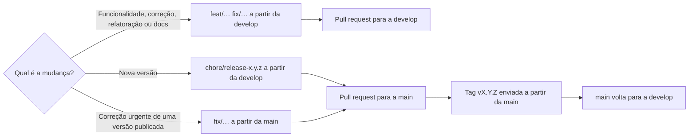
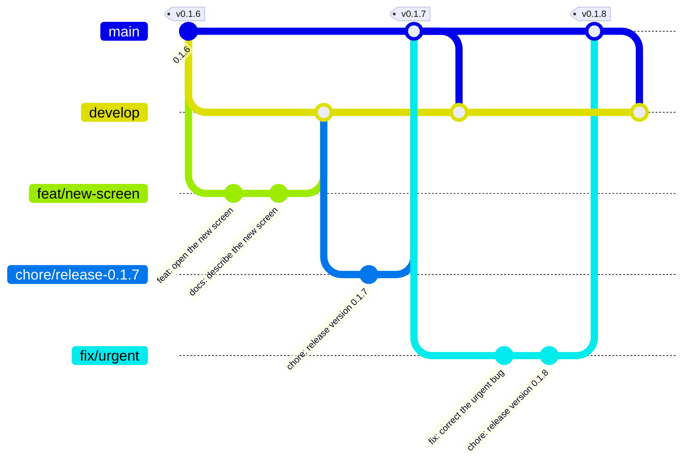

# Como contribuir

[English](CONTRIBUTING.md) | **Português (Brasil)**

Obrigado pelo interesse! Issues e pull requests são bem-vindos.

## Preparando o ambiente

```bash
git clone https://github.com/lucascodev/aura-datadock-db.git
cd aura-datadock-db
npm install
docker compose -f docker-compose.dev.yml up -d
```

Abra a pasta no VS Code e pressione `F5`. O `docker-compose.dev.yml` sobe um Postgres e um MySQL com tabelas de exemplo para testar. Os seeds só rodam na criação do banco; depois de alterá-los, recrie os containers com `docker compose -f docker-compose.dev.yml down -v` seguido de `up -d`.

## Branches

O projeto segue o git flow, mantendo nas branches os prefixos dos tipos de commit.

- `main` guarda o que foi publicado, e cada versão é uma tag `vX.Y.Z` nela. Ela só recebe releases e correções urgentes.
- `develop` reúne o trabalho da próxima versão. Abra os pull requests contra ela.
- Uma mudança sai da `develop` em uma branch com o nome do tipo, como `feat/…`, `fix/…`, `refactor/…`, `docs/…` ou `chore/…`.
- Uma release sai da `develop` em `chore/release-x.y.z`, que só define a versão e põe a data no changelog. Ela entra na `main`, a tag é enviada a partir da `main` depois desse merge, e a `main` volta para a `develop`.
- Uma correção urgente de uma versão publicada sai da `main` em `fix/…`, entra na `main` e depois na `develop`.

De onde cada branch sai e onde ela termina:



O mesmo fluxo ao longo do tempo, de uma mudança até a release e uma correção urgente depois dela:



Os nomes dos commits ficam em inglês, como no repositório.

Os commits seguem o Conventional Commits, como `feat: open a chart from the table screen`, com um commit para cada mudança lógica.

## Padrões de código

- Código, nomes e mensagens de commit em inglês.
- A documentação existe em inglês e em português do Brasil, e uma mudança atualiza as duas versões. O texto da interface também existe nos dois idiomas.
- Clean Code como referência: funções pequenas, nomes que explicam a intenção, um conceito por arquivo.
- Sem comentários no código. Se algo precisa de explicação, prefira um nome melhor ou extraia uma função. Decisões de arquitetura ficam em [docs/architecture.pt-BR.md](docs/architecture.pt-BR.md).
- Dependências apontam só para dentro, como descrito em [docs/architecture.pt-BR.md](docs/architecture.pt-BR.md). `vscode` só aparece em `presentation/vscode` e em `main`, para o resto continuar utilizável pelo servidor MCP.
- O código em `presentation/webview` roda no navegador: não importa `vscode` nem APIs do Node, e fala com a extensão só por mensagens.
- Cada arquivo fica em uma subpasta do seu assunto. Uma pasta tem arquivos ou subpastas, nunca os dois, e no máximo 8 arquivos. Os testes em `test/architecture/` garantem essas regras.
- As pastas seguem camada, depois contexto, depois tipo, como em `application/query/model/`. `model/` guarda contratos, `ports/` interfaces para o lado de fora, `errors/` classes de erro e `constants/` dados compartilhados. As demais pastas têm nome de assunto e guardam lógica.
- Um tipo usado por outro arquivo tem arquivo próprio, com o nome do conceito. Um tipo usado só no próprio arquivo fica nele, sem `export`.
- Uma constante usada em um arquivo fica nele. A usada por mais de um arquivo vai para `constants/`, e a mesma informação nunca se repete. Valores iguais por coincidência continuam separados.
- Um arquivo exporta uma função, com o nome do arquivo. Uma auxiliar fica privada quando serve só a essa função; a usada por várias funções ganha arquivo próprio.
- No máximo 5 funções por arquivo, 30 linhas por função ou método e 20 métodos por classe. Uma função devolve o resultado em vez de alterar um parâmetro.
- Toda regra nova em `application` ou `infrastructure/docker` vem acompanhada de teste em `test/unit/`, na mesma árvore de `src`.
- Mudanças em SQL de adapter vêm com teste em `test/integration/`, que roda contra bancos reais.

Antes de abrir o pull request:

```bash
npm run typecheck
npm test
npm run test:integration
```

O `test:integration` usa o `docker-compose.test.yml`, com portas próprias e dados em memória, e remove os containers no final. Ele sobe também um Postgres com TLS e um servidor SSH, e por isso precisa de `ssh`, `ssh-keygen` e `ssh-keyscan` no `PATH`.

## Adicionando um driver

Tudo o que muda de um banco para outro fica em `src/drivers/` e `src/infrastructure/database/`. Nenhum outro código precisa saber que o banco existe, e um teste de arquitetura impede comparações com o id do driver fora dessas duas pastas.

1. Crie `src/drivers/<banco>/descriptor.ts` com um `DriverDescriptor`: nome, porta padrão, esquemas de connection string, dialeto e, se houver imagem oficial, a descoberta no Docker.
2. Registre a descrição em `src/drivers/catalog/driverDescriptors.ts`. O banco já aparece no formulário de conexão.
3. Crie `src/infrastructure/database/<banco>/adapter/<Banco>Adapter.ts` implementando `DatabaseAdapter`, se o protocolo for novo. Bancos compatíveis podem reaproveitar um adapter, como o MariaDB faz com o `MysqlAdapter`.
4. Registre o adapter em `src/infrastructure/database/constants/adapterFactories.ts`.
5. Inclua o banco em `docker-compose.test.yml`, `scripts/runIntegrationTests.mjs` e nas listas `engines` de `test/integration/adapters.test.ts` e `test/integration/tableEditing.test.ts`. Essa é a suíte de contrato que todo driver precisa passar.
6. Adicione o banco na lista do README, nas duas versões.

Um banco baseado em arquivo, como o SQLite, ainda precisa de uma mudança no formulário, que hoje sempre pede host e porta.

## Traduções

O inglês é a fonte, e cada mensagem em inglês é a sua própria chave. O código chama `l10n.t('Message {0}', value)`, de `src/domain/i18n/translation/l10n.ts`; o primeiro argumento é sempre um literal de string simples. Nunca chame essa função na carga do módulo, porque o catálogo só é definido no `activate()` e no topo do `main.ts` de cada webview: use uma função ou um campo preguiçoso.

- O texto em tempo de execução é traduzido em `l10n/bundle.l10n.pt-br.json`.
- Os textos do `package.json` usam `%chave%`, com `package.nls.json` e `package.nls.pt-br.json`.
- Os testes falham se uma chave estiver ausente ou tiver placeholders diferentes.
- Para adicionar um idioma, crie os mesmos dois arquivos para o locale dele.

Não são traduzidos de propósito: os logs do canal Output, as descrições das ferramentas MCP, o prompt enviado aos modelos de IA e o SQL, o DDL e os arquivos de export gerados.

## Reportando problemas

Inclua a versão do VS Code, o sistema operacional, como o Docker está instalado (Desktop, Engine, Colima, Podman) e a imagem do banco. A aba **Output > Aura DataDock DB** mostra os logs da extensão.
