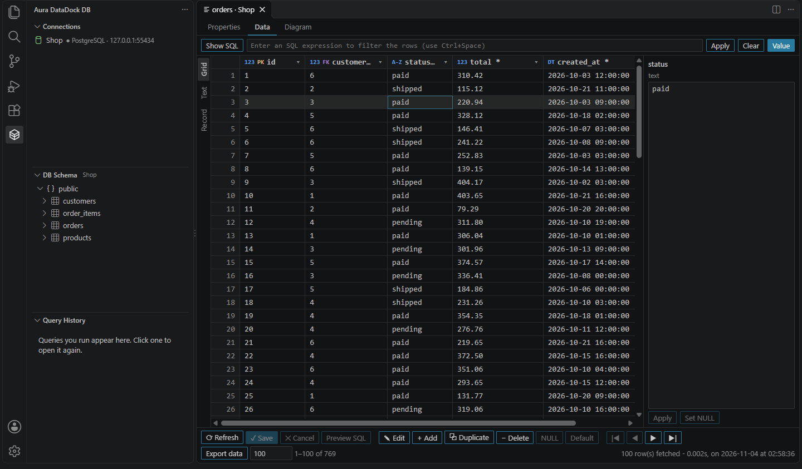
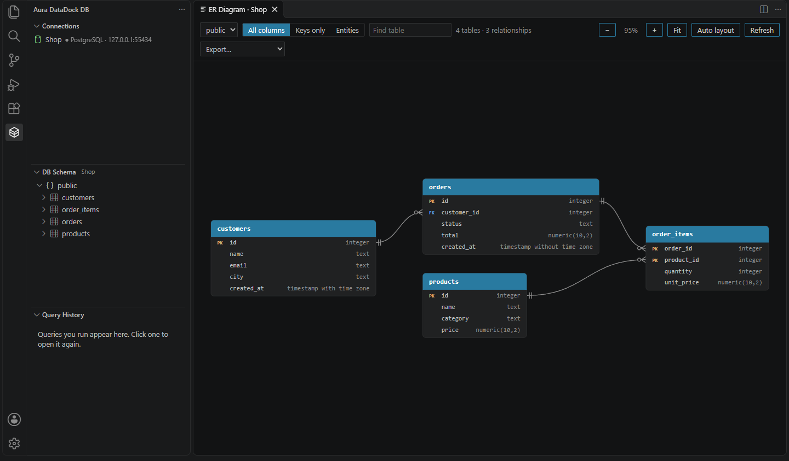
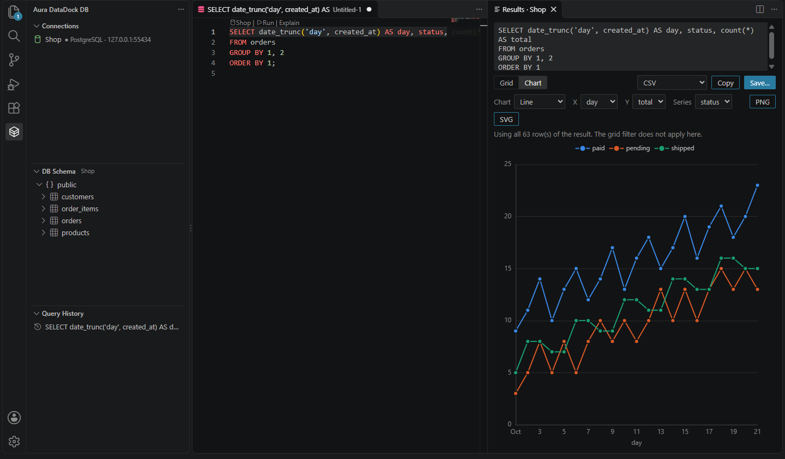

<h1 align="center"></h1>

[English](README.md) | **Português (Brasil)**

Extensão open source para VS Code que conecta aos seus bancos Postgres, MySQL e MariaDB. Os que rodam em containers Docker aparecem sozinhos, sem nenhuma configuração, e os demais você adiciona com conexão direta ou por túnel SSH. Ela mostra schemas, tabelas e colunas na barra lateral, desenha o diagrama do banco, executa queries, exporta dados e schema, e entrega o schema para a IA que você já usa.

## Capturas de tela

**Navegue e edite os dados da tabela**

<p align="center"></p>

**Veja o diagrama do banco**

<p align="center"></p>

**Transforme o resultado de uma query em gráfico**

<p align="center"></p>

## Recursos

- **Descoberta automática**: detecta containers de Postgres, MySQL e MariaDB (incluindo PostGIS, TimescaleDB e pgvector) e lê usuário, senha e banco das variáveis de ambiente do container.
- **Conexões salvas**: bancos locais ou remotos, com TLS, túnel SSH e connection string. O Docker é opcional.
- **Seção DB Schema**: schemas, tabelas, views, colunas, índices e chaves estrangeiras da conexão selecionada, com filtro e ações no menu.
- **Tela de tabela**: abas Propriedades, Dados e Diagrama. Edite células, adicione, duplique e exclua linhas, filtre por expressão SQL, veja os dados em grade, texto ou registro, e rode SQL embaixo da grade, com gravação em transação.
- **Drivers**: PostgreSQL, MySQL e MariaDB, com arquitetura pronta para novos bancos.
- **Diagrama ER / MER**: tabelas e relacionamentos em notação pé-de-galinha, com cardinalidade derivada das constraints, nos níveis todas as colunas, só chaves e só entidades.
- **Editor de queries**: executa a seleção, o comando sob o cursor ou o arquivo inteiro, com autocomplete de tabelas e colunas, `EXPLAIN`, cancelamento e histórico. Cada arquivo fica ligado ao seu banco.
- **Grade de resultados**: uma aba por comando, ordenação, filtro, cópia de célula, linha ou coluna, e rolagem fluida com muitas linhas.
- **Gráficos**: veja o resultado de uma query como linha, área, barras, pizza, dispersão com regressão, histograma, boxplot ou heatmap, e exporte em PNG ou SVG.
- **Export**: resultados e tabelas inteiras em CSV, JSON, NDJSON, Markdown e SQL `INSERT`; schema em DDL, Mermaid, DBML e JSON; diagrama em SVG e PNG.
- **Proteções**: somente leitura global ou por conexão, confirmação antes de `DROP`, `TRUNCATE`, `ALTER` e de `DELETE` ou `UPDATE` sem `WHERE`, e confirmação de qualquer escrita em banco remoto.
- **IA para gerar SQL**: descreva o que precisa e a extensão escreve a query a partir do schema real, incluindo as chaves estrangeiras. Funciona com os modelos do VS Code (GitHub Copilot), Anthropic, OpenAI ou Ollama local.
- **Servidor MCP para leitura, desligado por padrão**: agentes como o modo agente do VS Code, Claude Code e Cursor conseguem listar bancos, ler o schema e rodar consultas de leitura.
- **Interface em português e inglês**: a interface está disponível em inglês e em português do Brasil e segue o idioma de exibição do VS Code.

## Requisitos

- VS Code 1.101 ou superior
- Para a descoberta automática: Docker em execução (Docker Desktop, Docker Engine, Colima ou Podman com socket compatível) e a porta do banco publicada para o host, por exemplo `-p 5432:5432`
- Para túnel SSH: o comando `ssh` do OpenSSH no `PATH`, que já vem no Windows 10 ou superior, no macOS e na maioria das distribuições Linux

Nada disso é necessário para uma conexão direta. A extensão não tem banco próprio nem serviço externo.

## Como usar

1. Abra a aba **Aura DataDock DB** na barra de atividades.
2. Conecte a um banco:
   - **Com Docker:** suba o banco em um container e ele aparece sozinho, em até 15 segundos. Para testar, use o [`docker-compose.dev.yml`](docker-compose.dev.yml) deste repositório:
     ```bash
     docker compose -f docker-compose.dev.yml up -d
     ```
   - **Sem Docker ou banco remoto:** clique em **Adicionar conexão**.
3. Clique na conexão. A seção **Schemas** mostra os schemas e as tabelas dela.
4. Clique em uma tabela para ver e editar os dados, ou use **Nova query** na conexão para abrir um editor SQL.
5. Use **Mostrar diagrama ER** na conexão ou no schema para ver o diagrama.
6. Use **Gerar SQL com IA** no topo da aba para escrever uma query em linguagem natural.

Se a senha do container vier de um arquivo de secret (`POSTGRES_PASSWORD_FILE`, por exemplo), clique no container para informar a senha. Ela fica no cofre do sistema operacional.

### Adicionando uma conexão

O formulário de **Adicionar conexão** tem três abas. Cole uma connection string (`postgres://`, `mysql://`, `mariadb://`) para preencher os campos, e use **Testar conexão** antes de salvar.

| Aba | O que configura |
| --- | --- |
| **Conexão** | Nome, banco, host, porta, usuário, senha e database |
| **Segurança** | TLS e somente leitura |
| **SSH** | Túnel SSH: host, porta, usuário, chave e jump host |

Modos de TLS:

| Modo | O que faz | Quando é o padrão |
| --- | --- | --- |
| **Desligado** | Sem criptografia | Host local ou conexão por túnel SSH |
| **Obrigatório** | Criptografa, sem validar o certificado | Nunca |
| **Verificado** | Criptografa e valida o certificado | Host remoto |

Em bancos como Amazon RDS, o modo **Verificado** precisa do arquivo de CA do provedor. No MySQL por túnel SSH, ele valida a cadeia do certificado, mas não o nome do host, porque o driver não permite informar o nome real.

O túnel usa o `ssh` do sistema, então valem seu `~/.ssh/config`, chaves, `ssh-agent` e `known_hosts`. Três limitações:

- Login por senha não é aceito. Chaves com passphrase precisam estar no `ssh-agent`.
- Um servidor desconhecido precisa ser aceito uma vez, conectando pelo terminal. A extensão não aceita chaves de host sozinha.
- O host do banco é resolvido pelo servidor SSH, então `localhost` significa o próprio servidor.

### Editando dados

Clicar em uma tabela abre uma aba com três partes:

- **Propriedades**: colunas, índices, referências nos dois sentidos e o DDL, com **Copiar** e **Abrir no editor**.
- **Dados**: as linhas, paginadas no servidor (`auraDataDockDb.table.pageSize`).
- **Diagrama**: a tabela e seus vizinhos diretos. Duplo clique abre o vizinho.

Na aba **Dados**:

| Ação | Como |
| --- | --- |
| Editar uma célula | Duplo clique, `Enter` ou `F2`; `Enter` confirma, `Tab` vai para a próxima coluna editável e `Esc` cancela |
| Mover a seleção | Setas e `PageUp`/`PageDown` |
| Copiar a célula | `Ctrl+C` |
| Ver ou editar um valor longo | Painel **Valor**, com JSON formatado; **Aplicar** leva o valor para a célula |
| Gravar NULL | **NULL** na barra inferior, ou **Definir NULL** no painel |
| Usar o padrão do banco em uma linha nova | **Padrão** na barra inferior |
| Adicionar uma linha | **+ Adicionar**; coluna sem valor usa o default do banco, e `*` marca as obrigatórias |
| Duplicar linhas | **Duplicar**; copia os valores para novas linhas, sem colunas geradas e sem chave primária com default |
| Selecionar linhas | Clique no número da linha; `Ctrl` alterna e `Shift` seleciona um intervalo |
| Excluir linhas | `Delete` ou **− Excluir**, nas linhas selecionadas ou na da célula atual; repetir desfaz a marcação |
| Ordenar | Clique no cabeçalho: crescente, decrescente, sem ordem |
| Filtrar por uma coluna | Menu ▾ da coluna: pelo valor da célula selecionada, contém, `IS NULL`, `IS NOT NULL` |
| Filtrar por expressão | Escreva o `WHERE` no campo do topo e tecle `Enter`; `Ctrl+Space` sugere colunas e operadores |
| Ajustar a largura | Arraste a borda do cabeçalho |
| Trocar a visualização | **Grade**, **Texto** (tabela de texto, fácil de copiar) ou **Registro** (uma linha por vez), à esquerda |
| Mudar o tamanho da página | Campo ao lado de **Exportar dados** |
| Ver o que será executado | **Prévia do SQL** |
| Salvar | **Salvar** ou `Ctrl+S` |

Nada é gravado até **Salvar**, que aplica tudo em uma transação: se uma alteração falhar, nenhuma é salva e elas continuam pendentes. As alterações sobrevivem à troca de página. Se você fechar a aba com alterações pendentes, a extensão oferece reabrir com elas.

**Mostrar SQL** abre embaixo da grade o `SELECT` da tela, que você pode editar e rodar com `Ctrl+Enter`:

- Um único comando de leitura mostra o resultado na própria grade, só para leitura, até **Voltar à tabela**. Ele traz no máximo o tamanho da página.
- Qualquer outra coisa segue o caminho de uma query normal, com as mesmas confirmações, e o resultado aparece no painel de resultados.

A expressão do filtro é SQL escrito por você, e só pode ser um único comando de leitura. Essa checagem analisa o texto e não enxerga o efeito de uma função chamada dentro da expressão. Em uma conexão somente leitura, o próprio banco bloqueia a escrita; nas demais, o risco é o mesmo de escrever a query no editor.

Cada linha é identificada pela chave primária, e cada alteração precisa afetar exatamente uma linha. Se outra pessoa tiver removido a linha, nada é salvo. Por outro lado, se duas pessoas editarem a mesma linha, vale a última gravação.

Limites:

- Tabela sem chave primária aceita só novas linhas, e a ordem pode mudar entre páginas.
- Views e conexões somente leitura não podem ser editadas.
- Colunas geradas, identity `ALWAYS` e binárias ficam só leitura.
- Tipos complexos, como array e JSON, são editados como texto no formato do banco.

### Alterando a estrutura

O menu da árvore tem **Criar tabela**, **Adicionar coluna**, **Renomear tabela**, **Renomear coluna**, **Excluir coluna**, **Criar índice**, **Esvaziar tabela** e **Excluir tabela**. Essas ações não executam nada sozinhas: elas abrem o SQL em um editor, para você revisar e rodar com `Ctrl+Enter`, passando pelas mesmas proteções de qualquer query.

### Bancos remotos

Um banco remoto pode ser produção, por isso:

- Novas conexões remotas vêm em **somente leitura**. A proteção vale na extensão e na sessão do banco.
- Sem o somente leitura, **qualquer escrita pede confirmação**, mesmo com `auraDataDockDb.confirmDestructiveQueries` desligado.
- Uma conexão salva **nunca vira a conexão ativa sozinha**. Ela só é usada depois de você escolher.
- A árvore, o editor e a barra de status mostram quando o banco é remoto.

### Executando queries

| Ação | Como |
| --- | --- |
| Executar a seleção ou o comando sob o cursor | `Ctrl+Enter` (`Cmd+Enter` no macOS) ou **Executar** acima do comando |
| Executar todos os comandos do arquivo | `Ctrl+Shift+Enter` (`Cmd+Shift+Enter` no macOS) |
| Ver o plano de execução | **Explicar** acima do comando |
| Cancelar | **Cancelar** no painel de resultados ou **Aura DataDock DB: Cancelar query em execução** |
| Trocar o banco do arquivo | Clique no nome do banco no topo do arquivo ou na barra de status |

Comandos em sequência rodam um por vez e param no primeiro erro, com um resultado por comando. Cada um é confirmado separadamente; para agrupar, use `BEGIN` e `COMMIT` no próprio arquivo. Clique duas vezes em uma célula para abrir o valor completo em um editor, com JSON formatado.

### Gráficos

Depois de rodar uma query, troque de **Grade** para **Gráfico** no painel de resultados. A extensão sugere um gráfico pelo formato do resultado, e você troca o tipo e as colunas nos campos acima dele.

```sql
SELECT date_trunc('day', created_at) AS dia, status, count(*) AS total
FROM orders
GROUP BY 1, 2
ORDER BY 1;
```

Essa query vira um gráfico de linhas por dia, com uma série para cada `status`.

| O resultado tem | Sugestão |
| --- | --- |
| 1 linha e 1 valor | O número em destaque |
| Data e número | Linha |
| Categoria e número | Barras |
| Duas categorias e número | Heatmap |
| Dois números | Dispersão, com linha de tendência e R² opcionais |
| Um número em várias linhas | Histograma |

Área, pizza e boxplot ficam disponíveis no campo **Gráfico**. **PNG** e **SVG** salvam o gráfico com fundo claro.

O gráfico usa as linhas que a query retornou e avisa, acima dele, quando:

- o resultado foi cortado por `auraDataDockDb.maxRows`, porque o gráfico fica parcial. Prefira agregar com `GROUP BY`;
- há linhas com `NULL` ou valores que não são números, que ficam de fora;
- há linhas repetidas para a mesma posição, que são somadas;
- há séries demais: acima de 8, ou de 3 na dispersão, as excedentes viram **Outros**;
- um inteiro é grande demais para ser desenhado exatamente. A grade continua mostrando o valor exato.

O filtro da grade não se aplica ao gráfico. Datas aparecem como o banco devolveu, sem conversão de fuso.

### Diagrama

Arraste as tabelas para organizar, use a roda do mouse para o zoom e arraste o fundo para navegar. As posições ficam salvas por container e schema, e **Layout automático** volta à organização automática. Clique em uma tabela para destacar os relacionamentos dela e clique duas vezes para abrir os dados.

Os relacionamentos vêm das chaves estrangeiras declaradas no banco. Uma chave estrangeira para outro schema não desenha linha: a coluna aparece como `FK` e o destino fica na dica da coluna.

### Export

- **Resultado de uma query**: escolha o formato na grade e use **Salvar…** ou **Copiar**. Vão todas as linhas retornadas, até o limite de `auraDataDockDb.maxRows`, sem considerar filtro e ordenação da grade.
- **Tabela inteira**: **Exportar tabela…** no menu da tabela. Os dados são lidos em lotes e gravados direto no arquivo, com progresso e cancelamento, sem o limite de `maxRows`.
- **Linhas filtradas**: **Exportar dados** na aba **Dados**. Exporta todas as linhas que atendem aos filtros e à ordenação da tela, da mesma forma, e não só a página atual.
- **Schema**: **Exportar schema…** no container, no schema ou no menu do diagrama. **Mostrar DDL** no menu da tabela abre o DDL em um editor.
- **Diagrama**: menu **Exportar…** do diagrama, em SVG ou PNG, sempre com fundo claro.

O DDL é gerado a partir do catálogo do banco e inclui colunas, chaves primárias e estrangeiras, índices, defaults e views. Triggers, check constraints, functions e tipos personalizados não entram, e views materializadas saem como views comuns. Para um backup completo, use `pg_dump` ou `mysqldump`.

## Configurações

| Configuração | Padrão | Descrição |
| --- | --- | --- |
| `auraDataDockDb.readOnly` | `false` | Bloqueia qualquer comando de escrita em todas as conexões, na extensão e na própria sessão do banco |
| `auraDataDockDb.connections` | `[]` | Conexões salvas, sem as senhas. Só vale nas configurações do usuário; gerencie pelo formulário |
| `auraDataDockDb.confirmDestructiveQueries` | `true` | Pede confirmação antes de comandos destrutivos |
| `auraDataDockDb.maxRows` | `500` | Limite de linhas exibidas no resultado |
| `auraDataDockDb.table.pageSize` | `100` | Linhas por página no editor de dados |
| `auraDataDockDb.codeLens.enabled` | `true` | Mostra o banco do arquivo e as ações Run e Explain em arquivos SQL |
| `auraDataDockDb.history.maxEntries` | `200` | Quantas queries manter no histórico; `0` desliga |
| `auraDataDockDb.dockerHost` | vazio | Endpoint do Docker; vazio usa `DOCKER_HOST` ou o padrão do sistema |
| `auraDataDockDb.ai.provider` | `vscode` | `vscode`, `anthropic`, `openai` ou `ollama` |
| `auraDataDockDb.ai.model` | vazio | Modelo do provedor; vazio usa o padrão |
| `auraDataDockDb.ai.ollamaUrl` | `http://localhost:11434` | Endereço do Ollama |
| `auraDataDockDb.mcp.enabled` | `false` | Expõe os bancos para agentes via MCP. Só vale nas configurações de usuário |

Chaves de API são salvas com o comando **Aura DataDock DB: Definir chave de API do provedor de IA** e, como as senhas, ficam no cofre do sistema, nunca no `settings.json`.

## Privacidade

- Para gerar SQL, só a estrutura do banco (tabelas, colunas, tipos e chaves) é enviada ao modelo. Dados das linhas nunca saem da sua máquina.
- Com o provedor `ollama`, nada sai da sua máquina.
- O histórico guarda o texto das queries localmente, no armazenamento do VS Code. Use `auraDataDockDb.history.maxEntries` igual a `0` se elas puderem conter dados sensíveis.
- A extensão não coleta telemetria.

## Segurança

- As configurações que decidem onde a extensão conecta ou envia dados (`dockerHost`, `connections`, `ai.provider`, `ai.model`, `ai.ollamaUrl` e `mcp.enabled`) só valem nas configurações de usuário. Um repositório não consegue defini-las.
- Um repositório pode ligar `readOnly` e `confirmDestructiveQueries`, mas não pode desligá-las.
- A extensão não roda em um workspace que você não marcou como confiável.
- O modo somente leitura bloqueia escritas e funções conhecidas que agem no servidor, e no Postgres cada leitura roda em uma transação somente leitura que é desfeita. Isso reduz o risco, mas não substitui permissões: em um banco sensível, conecte com um usuário que só possa ler o necessário.
- Nos exports em CSV, uma célula de texto que uma planilha executaria como fórmula começa com `'`. Os outros formatos mantêm o valor exato.
- O modo TLS **Obrigatório** criptografa sem validar o certificado, então use **Verificado** fora de uma rede confiável. Um endpoint Docker `tcp://` não é criptografado.

Para relatar uma vulnerabilidade, veja [SECURITY.pt-BR.md](SECURITY.pt-BR.md).

## Usando o servidor MCP fora do VS Code

No VS Code, ligue `auraDataDockDb.mcp.enabled` nas configurações de usuário para registrar o servidor. Para usar em outros clientes, aponte para o arquivo `dist/mcp-server.js` da extensão instalada. Exemplo com Claude Code no Windows, em que `0.1.1` é a versão instalada:

```bash
claude mcp add aura-datadock-db -- node "%USERPROFILE%\.vscode\extensions\lucascodev.aura-datadock-db-0.1.1\dist\mcp-server.js"
```

Ferramentas disponíveis:

| Ferramenta | O que faz |
| --- | --- |
| `list_databases` | Lista os bancos encontrados nos containers e se podem ser consultados |
| `describe_schema` | Retorna tabelas, colunas e chaves estrangeiras de um banco |
| `run_query` | Executa uma consulta de leitura por vez e devolve as linhas em JSON |

O servidor recusa o que classifica como escrita e lê dentro de uma sessão somente leitura. Os agentes veem todas as linhas que leem e usam as credenciais do container, que muitas vezes são de administrador. Use com dados de desenvolvimento. Ele só enxerga bancos em containers Docker: as conexões salvas não ficam disponíveis para agentes.

## Desenvolvimento

```bash
npm install
npm run watch
```

Depois pressione `F5` no VS Code para abrir uma janela com a extensão carregada. Outros comandos:

| Comando | Descrição |
| --- | --- |
| `npm run build` | Gera a extensão, o servidor MCP e as webviews em `dist/` com esbuild |
| `npm run typecheck` | Verifica os tipos da extensão e das webviews com TypeScript |
| `npm test` | Roda os testes com Vitest |
| `npm run test:integration` | Sobe bancos temporários no Docker e testa os adapters contra eles |
| `npm run package` | Gera o arquivo `.vsix` |

A organização do código está explicada em [docs/architecture.pt-BR.md](docs/architecture.pt-BR.md) e o passo a passo para contribuir em [CONTRIBUTING.pt-BR.md](CONTRIBUTING.pt-BR.md).

## Licença

[MIT](LICENSE). A extensão inclui pacotes de código aberto, com licenças próprias, listados em [THIRD_PARTY_NOTICES.md](THIRD_PARTY_NOTICES.md).
